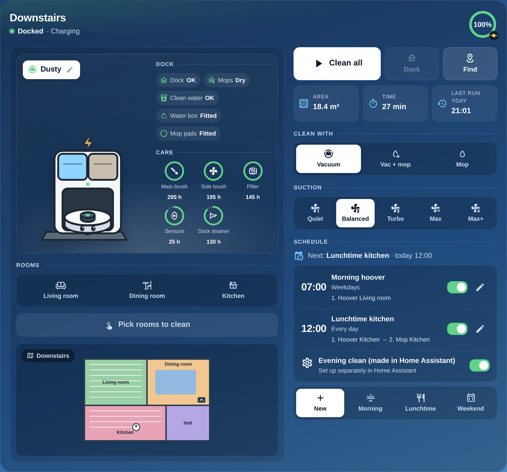
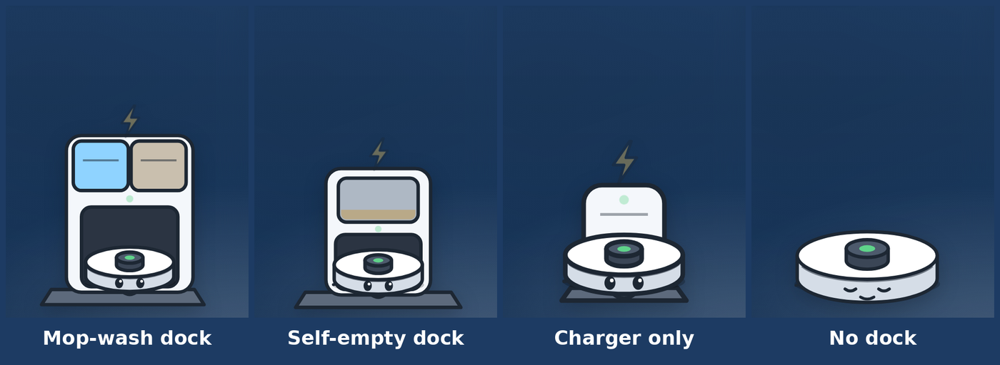
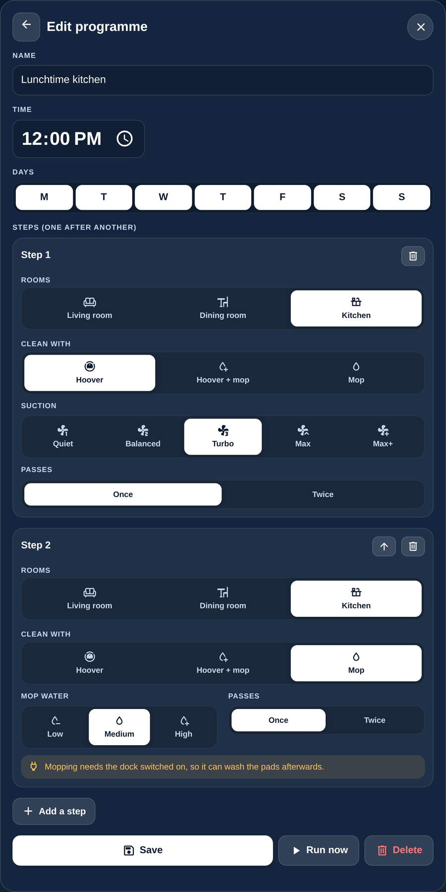
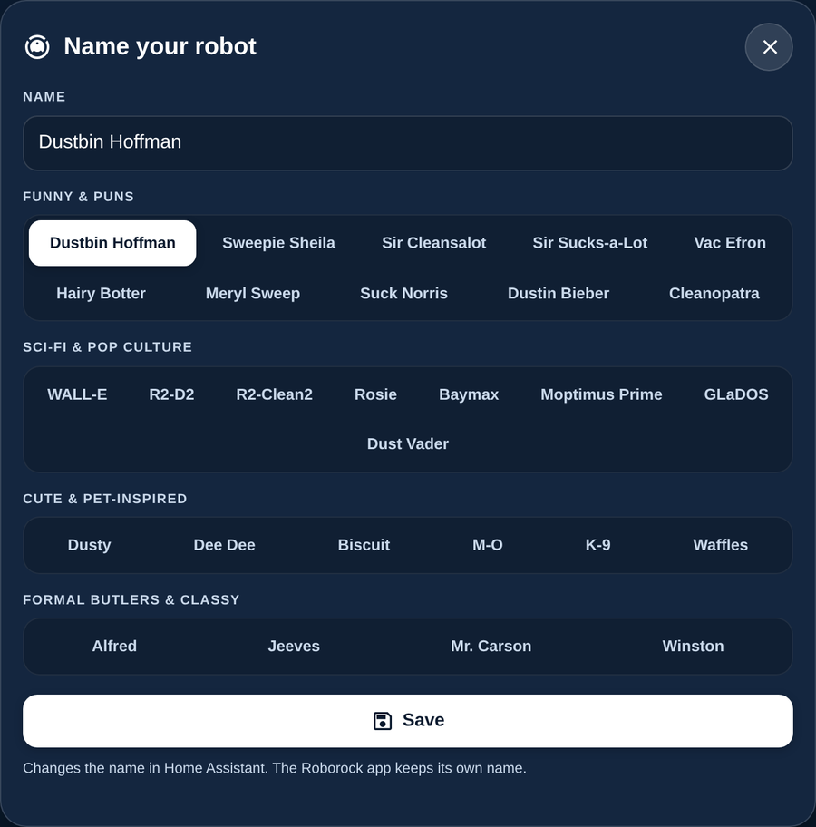

# Roborock Buddy Card

A friendly dashboard card for Roborock robot vacuums in Home Assistant: a cartoon of your robot and its dock that follows what it's doing, the live map, tap-to-pick rooms, all the controls, dock and brush status, and a **cleaning schedule** you set up right on the card.

📖 [Step-by-step guide and live demo](https://mymediabuild.uk/home-assistant-roborock-buddy-card/) · ☕ [Buy me a coffee](https://buymeacoffee.com/bobgreggr)

[](https://my.home-assistant.io/redirect/hacs_repository/?owner=spikey1965&repository=ha-roborock-buddy-card&category=plugin)



> **Beta (0.1.1).** It runs every day on my own Roborock Qrevo S and Q7 L5+. If you try it on another model, please [open an issue](https://github.com/spikey1965/ha-roborock-buddy-card/issues) with what works and what doesn't.

## What it does

- **A cartoon of your robot and dock** that follows what it's doing: asleep on the dock, charging, out cleaning (with a trail), heading home, paused, stuck, washing or drying the mops, and dust clouds while the dock empties the bin.
- **Four robot types**, picked for you from your robot's own entities: mop-wash dock, self-empty dock, charger only, or no dock.
- **Name your robot**: tap the name tag and pick a name from the list (Dustbin Hoffman, Moptimus Prime, Jeeves…) or type your own.
- **A status line that says what it's doing**: "Cleaning · Kitchen", "Charging", "Drying the mops", with a progress bar, and a red banner when it's stuck ("Main brush jammed").
- **The live map**, with its empty border trimmed off so the rooms are as big as possible.
- **Tap rooms to clean** them, or one big **Clean all / Pause / Resume** button, plus Dock and Find.
- **Clean just a zone** (new in 0.2.0): press **Zone**, drag a box over the bit you want cleaned (up to five boxes), and press Clean. No setup.
- **Clean with, suction, mop water and mop route** as icon buttons. The options that only make sense in the Roborock app (Custom, Smart mode) are left out.
- **Dock and care at a glance**: dock errors, mop drying, clean water, water box and mop pads, and rings for the main brush, side brush, filter, sensors and dock strainer.
- **A schedule on the card**: programmes like "07:00 weekdays: hoover the living room" or "12:00 every day: hoover the kitchen, then mop it". Each programme is a list of steps run one after another.
- Phones, tablets and wall panels.



## The schedule

Each programme you make is saved as a **normal Home Assistant automation** (named "Robot: …"). It runs at its time even when no dashboard is open, it survives restarts, and you can see it in **Settings → Automations**.

- Pick the time, the days, and one or more steps. For each step: the rooms, hoover / hoover + mop / mop, suction, mop water and once or twice.
- Steps run one after another: it loads the right map, sets the mode, sends the rooms, waits for the robot to finish and settle on its dock, then starts the next step.
- If the robot isn't on its dock at the time (say it's been carried to another floor), the programme is skipped and you get a notification.
- Start from a suggestion (Morning, Lunchtime, Weekend) or press **New**. Each programme has an on/off switch, **Run now** and **Delete**.
- Automations you made yourself can show in the same list with their own switch (`also_show`).
- Saving, changing and deleting programmes needs a Home Assistant **admin** login. Anyone can see them.

<p align="center"> &nbsp; </p>

## What you need

- A Roborock robot vacuum on Home Assistant's own **Roborock** integration (Settings → Devices & services → Add integration → Roborock).
- Home Assistant 2025.1 or newer. The Q7 M5 family needs a recent version (2026.10 has it).

| Robot | Status |
|---|---|
| Qrevo, QV, S and Saros series | Tested on a Qrevo S (mop-wash dock) |
| Q7 M5 / M5+ / L5 family | Tested on a real Q7 L5+ (add `dock: empty`). Different room-clean command, no "emptying" status |
| Other Q-series | Should work if the Roborock integration supports your robot |

## Install

### Marketplace (easiest)

Click the button above. If asked, connect GitHub and click **Add**, then click **Install**. Or do it by hand:

1. Go to **Settings → Marketplace** and click **Add from link**. This asks you to connect GitHub.
2. Paste `https://github.com/spikey1965/ha-roborock-buddy-card` and choose the type **Dashboard** if asked.
3. Find **Roborock Buddy Card** under **New**, open it and click **Install**. Refresh your browser.

Because it's a beta, Marketplace shows a short code such as `f5fa069` instead of a version number, which is normal. To get the numbered beta instead, open the **⋮ menu → Include pre-releases → Include** before you install.

The first time you use Marketplace, tick **I understand the risks and agree** and click **Continue**.

**On a version older than 2026.11?** Marketplace is still called HACS there. Use **Download** in place of Install and **⋮ → Custom repositories** in place of Add from link.

### By hand

1. Download `roborock-buddy-card.js` from the [latest release](https://github.com/spikey1965/ha-roborock-buddy-card/releases) and copy it to `config/www/roborock-buddy-card/`.
2. **Settings → Dashboards → ⋮ → Resources → Add resource**: `/local/roborock-buddy-card/roborock-buddy-card.js?v=0.1.1`, type **JavaScript module**.
3. Refresh your browser.

## Add the card

With one robot, this is all you need:

```yaml
type: custom:roborock-buddy-card
```

With two robots, or a robot that has a map for each floor:

```yaml
type: custom:roborock-buddy-card
name: Downstairs
entity: vacuum.dusty
map: Map 0
also_show:
  - automation.my_evening_clean
notify: notify.mobile_app_my_phone
```

## Options

Every option is optional.

| Option | What it does | Example |
|---|---|---|
| `entity` | The vacuum to show. Leave it out if you have only one Roborock. | `vacuum.dusty` |
| `find` | Instead of `entity`: pick the robot by a word in its entity ID, name or model. | `"q7\|upstairs"` |
| `name` | The card's title. | `Downstairs` |
| `robot_name` | The name on the name tag, if you don't want to rename the robot in Home Assistant. | `Dusty` |
| `map` | Pin the card to one of the robot's maps (rooms and picture), and load that map before cleaning. For robots with a map per floor. | `Map 1` |
| `map_height` | The smallest height of the map, in pixels (default 300). | `260` |
| `zones` | `false` hides the Zone button. | `false` |
| `carry` | `true` for a robot you carry to this floor: it won't start while it's on its dock, and the picture shows no dock. | `true` |
| `mode` | Set the cleaning mode before every clean from this card. | `vacuum` |
| `skip` | Room IDs to leave out of the room list and "Clean all". | `[19]` |
| `dock` | Force the picture: `wash`, `empty`, `charger` or `none`. Normally picked for you. | `empty` |
| `schedule` | `false` hides the schedule. | `false` |
| `also_show` | Your own automations to list (with a switch) in the schedule. | `[automation.evening_clean]` |
| `notify` | A notify service to tell you when a programme is skipped. | `notify.mobile_app_phone` |
| `dock_hours` | Shown in the reminder on mop steps if your dock only has power at certain times. | `00:30-07:30` |
| `bin_helper`, `bin_every` | For robots without a self-empty dock: an `input_number` helper that remembers when you last emptied the bin, and how many runs between emptying (default 2). An **Emptied** button appears on the card. | `input_number.bin_emptied`, `3` |
| `where` | Shown in the "no map yet" message. | `upstairs` |

## Good to know

- **Renaming** from the card changes the robot's name in Home Assistant (the device name). The Roborock app keeps its own name, and entity IDs don't change.
- **Room names** come from the Roborock app. Name your rooms there; if new names don't show, reload the Roborock integration.
- **Mopping on a schedule** needs the dock to have power so it can wash the pads afterwards.
- **Zones** line up by themselves: the card finds the robot on Home Assistant's map and asks it where it is. Press Zone while the robot is standing still (on its dock is fine). The Q7 family can't clean zones from Home Assistant, so there's no Zone button for it.

## Support and requests

I build and look after this card in my spare time, so I can't promise every idea, but I read every issue. Pull requests are very welcome.

If the card saves you time, you can [buy me a coffee](https://buymeacoffee.com/bobgreggr). Thank you!

## Thanks

Thanks to the Home Assistant Roborock integration and python-roborock developers, who make all of this possible. The cartoon pictures are drawn for this card; Roborock is a trademark of its owner and this project isn't connected to them.

## Licence

MIT
